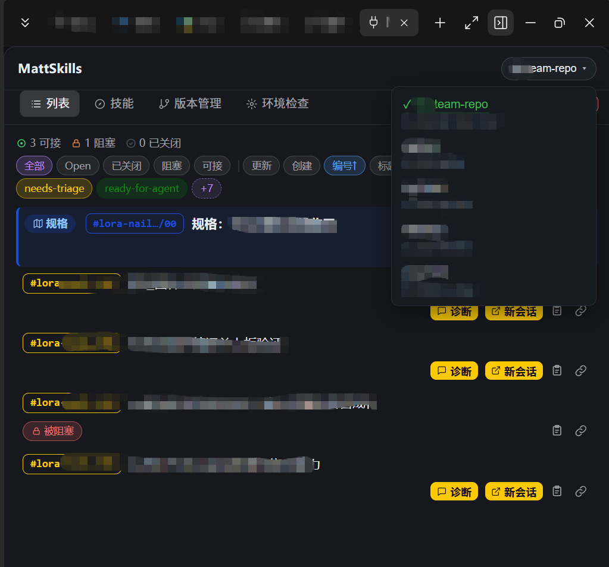
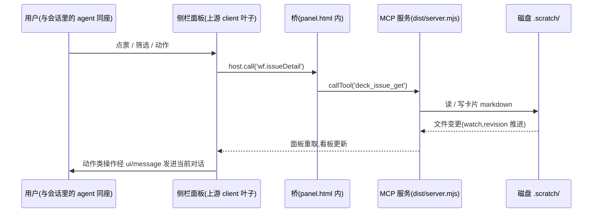

# zcode-mattskills-deck-sidebar

MattSkills Deck(DSH)在 ZCode 桌面端的侧栏移植:官方 UI Plugin(`ui.surfaces` + 同进程 MCP stdio server),右侧边栏 "MattSkills" 页签读写工作区 `.scratch/` 工单(0.7.0 起也可以是项目远端仓库的 GitHub 议题),agent 与人共用同一块数据。只移植侧边栏形态,上游对话框上的功能栏未引入。

## home-repo:多个项目共用一块看板

按 [home-repo pattern](https://www.aihero.dev/the-home-repo-pattern) 工作时,你会话打开的是一个 home-repo:它自己不放产品代码,只放技能、规范和一份指向各个项目仓库的导航。各个项目的看板散在各自的目录里,侧栏原本只能看到当前这一个。



这个插件让同一块看板在多个项目之间切换:

- **头部多了一枚项目 chip**。点开是项目清单:第一项打 ✓ 的是 home-repo,永远在;下面是别的项目,各带路径。点选即切换,列表、版本管理、环境检查三页一起换到那个项目。
- **清单不必手写**。还没有清单时,chip 的位置是一个「＋ 项目」入口。点它,插件自带的技能 `setup-home-repo` 会读 home-repo 里的 `AGENTS.md` 等文档,把里面指向别的项目的路径找出来,列一张候选表给你;你确认之后才写清单。
- **从别的项目的卡片点动作**,发进对话的指令会带上项目名和项目根,agent 知道该去哪个仓库干活。

清单是 home-repo 根下的 `.deck/projects.json`,一份普通的 JSON,可以手改。字段规则、清单损坏时的表现、技能的完整流程,见 [`zcode-plugin/README.md`](./zcode-plugin/README.md)。

## 插件是怎么搭起来的

ZCode 的官方 UI Plugin 只要求两样东西:一枚页签声明,一个服务进程。本插件的全部本体在 [`zcode-plugin/`](./zcode-plugin/),安装与架构细节见 [`zcode-plugin/README.md`](./zcode-plugin/README.md)。

```text
.zcode-plugin/plugin.json
  ui.surfaces  → "MattSkills" 页签(resourceUri ui://…/panel.html,挂 mattskills 服务)
  mcpServers   → node dist/server.mjs(stdio,cwd=工作区根)
  skills       → 携带技能目录(0.6.1 起:随插件分发,装了插件就有)

zcode-plugin/
├── skills/setup-home-repo/       # 把 home-repo 文档里的项目指针落成项目清单(写盘前须经用户确认)
├── dist/                        # 构建产物入库,装包即用,运行时零依赖
│   ├── server.mjs               # MCP 服务端:deck_* 工具族(读卡/写卡/技能/检查/地图/项目/git/议题)
│   ├── git.mjs                  # 上游 vc 核心+宿主文件打包(esbuild,~1MB)
│   ├── github-room.mjs          # 上游 GitHub 房间打包(esbuild,构建期从上游只读树克隆,~340KB)
│   └── ui/
│       ├── panel.html           # ext-apps 客户端骨架:握手两拍 + 资源通道
│       ├── bundle-1.txt         # 上游 client 本体 splice 产物(单作用域 IIFE)
│       └── assets.json
├── src/                         # 本仓真源:服务端、桥适配、构建胶水
│   ├── server.mjs / cards.mjs / write.mjs / watch.mjs
│   ├── registry.mjs             # 项目清单读取与校验(0.6.0 起)
│   ├── github/                  # 后端判定、gh 与仓库解析、房间装配、读写工具、变更探测(0.7.0 起)
│   ├── skill-roots.mjs          # 技能根单一真源(工作区→用户→插件内置)
│   └── node-shims.mjs / git-entry.mjs / github-entry.mjs  # Node 服务垫片与两条 bundle 的入口
├── build.mjs / build-upstream.mjs / build-git.mjs / build-github.mjs   # 四段构建,见下
└── test/                        # 33 套 3045 断言(0.7.0,含黄金对照 markdown-frozen 24 条)
```

运行时一条数据流:



## 上游是怎么搬进来的:字面搬运纪律

对上游 client 不重写、不裁剪,按它的拼接构建约定原样搬——上游演化时,标记序对账测试先报警:

```text
build-upstream.mjs(机制仿上游 scripts/build.mts)
  读上游 src/client/index.ts 的标记 // ==== leaf:xxx (spliced by build) ====
    (标记次序 = 声明次序)
  每个叶子 .ts → esbuild 转译 → 剥行首 export
  按标记序拼进本仓骨架的同名标记处 → 单作用域 IIFE(裸名共享)
  约束:骨架标记必须是上游标记序的保序子序列(const 暂时性死区防护,测试锁死)
  Preact(+compat) 顶替宿主 React;ctx 八服务走 Node 垫片
产物 dist/ui/bundle-1.txt —— 运行时不依赖上游树
```

版本管理页(0.4.0)同理:`build-git.mjs` 把上游 vc 家族的核心与宿主文件读图打包成 `dist/git.mjs`,客户端 `host.call('wf.gitX')` 全部映射到一条 `deck_git` 工具(60 余条电话)。

GitHub 后端(0.7.0)还是同一套纪律:`build-github.mjs` 从上游只读树读 GitHub 房间入口的 TS 图(无 npm 依赖),打成 `dist/github-room.mjs`;装机不依赖上游树,房间源码一字不改。新写的只有 Node 垫片(与版本管理页共用 `src/node-shims.mjs`)、构建胶水、出站控制面的直通实现,以及服务端的按后端分发(`src/github/`)。

对上游的有意偏离,清单在 [ADR-0002](./zcode-plugin/docs/adr/0002-hybrid-port-boundary.md) 的修订记录里:`deck_git` 的路径边界(工作区根内)、`withGhLane` 直通垫片;0.7.0 又添了几处,归在 [ADR-0004](./zcode-plugin/docs/adr/0004-github-backend.md):GitHub 房间整体克隆而不是重写、后端显式启用而不是按远端地址自动识别、仓库只从活动项目根解析、不做上游的额度账本与冷却窗口。面板本体的分叉只在头部——项目 chip、清单入口、后端 chip 和它们背后的刷新,都集中在本仓补件区,上游的列表、详情、动作模板零改动([ADR-0003](./zcode-plugin/docs/adr/0003-cross-project-switching.md) 与它的修订记录)。

## 一步步走过来

每个版本对应 `.scratch/` 里的一份规格(本仓工单纪律:spec → 工单 → 实施 → 收口):

| 版本 | 规格 | 搬了什么 |
|---|---|---|
| 0.1.x | (M1) | 官方页签 + stdio MCP + 手搓看板,先把壳和数据面立起来 |
| 0.3.0 | ui-fidelity U01–U06 | 换成 1:1 复刻:splice 构建 + ctx 垫片 + Preact,删旧手搓层 |
| 0.3.1 | m2-pages | 技能页签(真读本机技能目录)、环境检查页签(本地真实事实组链)、响应式宽度通道 |
| 0.3.2 | m2-pages/05 | 真机反馈修订:撤内容级宽度上限,宽侧铺满 |
| 0.4.0 | m3-version-control | 上游 vc 家族整体克隆:69 UI 叶 + 核心/宿主打包,`deck_git` 一条工具路由 |
| 0.5.0 | m4-map-detail | 地图详情页:mapV2 十三叶 + `deck_map_tickets` |
| 0.6.0 | m5-project-switch | `.deck/projects.json` 项目清单 + 活动项目切换,列表/版本/检查三页跟随 |
| 0.6.1 | m6-home-repo-setup | 清单入口(没有清单时头部的「＋ 项目」)+ 随插件分发的技能 `setup-home-repo`:读 home-repo 文档里的项目指针,给候选表、经确认后落成清单;清单状态刷新拍 |
| 0.7.0 | m7-github-backend | GitHub 后端:上游 GitHub 房间构建期克隆 + 服务端按后端分发 + 头部后端 chip;本地 Markdown 回包与 0.6.1 逐字一致 |

共同纪律:每版测试先行(外部可观察行为,不测实现细节)、版本双清单同步递增(装机靠版本号,热改缓存会被 ZCode 重启回滚)、市场源零构建垃圾。

## 分支

- `main`:上游快照入库(轻量,排除 assets/video 与 docs/prototype)——它是构建期真源,运行时不需要
- `zcode-plugin`:插件开发与发布分支(当前 0.7.0,默认分支)

## 归属与许可

MIT。上游:[FeatherHunter/dsh-mattpocock-skills-deck](https://github.com/FeatherHunter/dsh-mattpocock-skills-deck)。上游设计语言/数据契约/prompt 模板的引用边界见 [`zcode-plugin/NOTICE.md`](./zcode-plugin/NOTICE.md) 与 [`zcode-plugin/docs/adr/0002-hybrid-port-boundary.md`](./zcode-plugin/docs/adr/0002-hybrid-port-boundary.md)。
