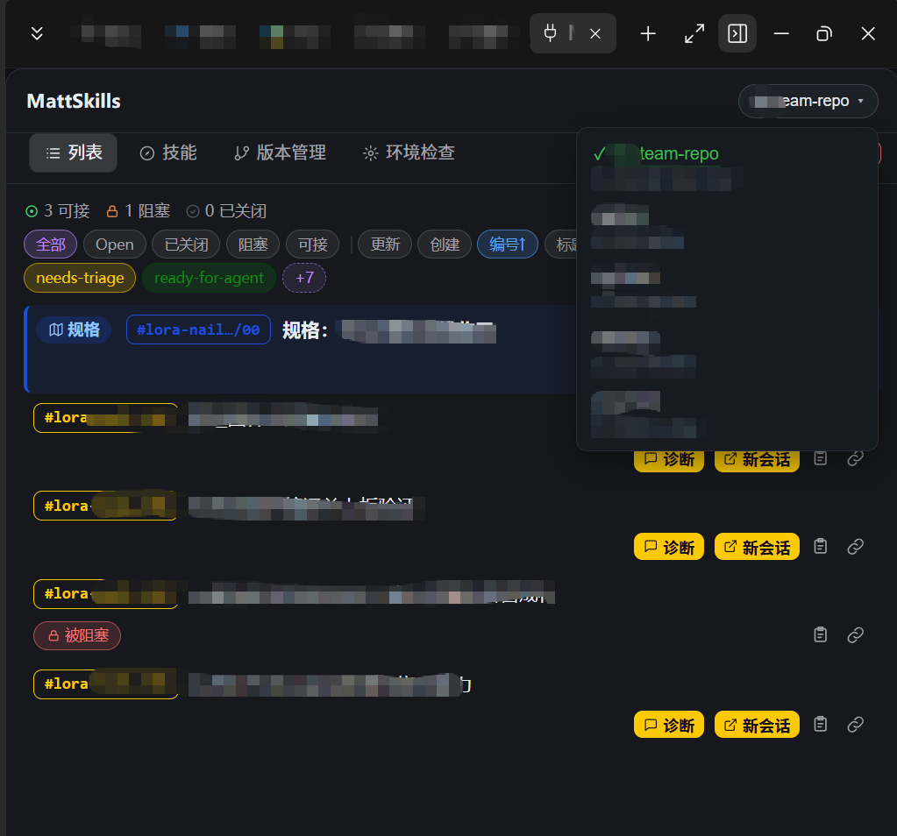

# zcode-mattpocock-skills-deck

MattSkills 任务看板的 ZCode 插件:侧边栏 "MattSkills" 页签(官方 `ui.surfaces`)+ 自带 MCP 服务读写工作区 `.scratch/` 工单(0.7.0 起也可以是项目远端仓库的 GitHub 议题),agent 与人共用同一块数据。

## 架构一句话

官方 UI Plugin 形态——manifest 声明 Surface 页签,面板经 `ui://` 资源加载并由内置桥(工具调用/消息发话/资源读取)连接同进程 MCP 服务;数据契约是上游 DSH deck 1.9.0-beta.33 的后端子集,数据源可以是本地 Markdown 卡片,也可以是 GitHub 议题(0.7.0 起,见下;术语见 `GLOSSARY.md` 与 `docs/adr/`);版本管理=上游 vc 家族整体克隆 + Node 垫片 + 一条 `deck_git`;0.6.0 起支持跨项目切换(项目清单 + 活动项目,见下)。

## 安装

1. 构建:`npm install` 后 `node build.mjs`(产物进 `dist/`,已入库,通常不需要;构建依赖 esbuild+preact,只进 bundle 产物,运行时零依赖)。
2. ZCode 里 **插件市场 → 添加 → 添加插件市场**,粘贴本目录(`zcode-plugin/`)路径。
3. 在 **个人 → dev-mattpocock-skills-deck → zcode-mattpocock-skills-deck → 安装**,并在设置中启用。
4. 新会话(或刷新)后,侧边栏出现 **MattSkills** 页签。无 `.scratch/` 时显示引导态。

试用:让 agent 跑 `/to-tickets` 拆解规格建卡,或直接说"列出我的工单"(调 `deck_issue_list`)。看板自动跟随磁盘变化。

## 面板(0.3.0 起:上游复刻唯一面板)

页签里只有一套面板:上游原样的 dsws-panel(上游 `src/client` 的 splice 拼接 bundle + Preact,见 `build-upstream.mjs` 与 ADR-0002 修订)。旧 ms-* UI 层与「切换上游面板壳」回退开关已在 U06 删除,无逃生舱。0.4.0 起四枚页签都是活视图:列表、技能(目录 + 文档详情)、版本管理(改动/提交历史/工作树三视图,写动作与危险动作走预检签票)、环境检查(链快照 + 重检),面板随侧边栏宽度自适应。版本管理整族从上游 vc 克隆,宿主取数打进 `dist/git.mjs`,只经一条 `deck_git` 工具路由。0.5.0 起列表里的地图/规格行点开就是上游 V2 地图详情页(mapV2 十三叶):档案区(标题/目的地/进度/子票那句)、子票卡片流(在办/可接/被挡/已完成)、点档案进这张图自己的详情页;子票全集经 `deck_map_tickets` 按需取回(含已关闭)。

列表 KPI 行右端是上游的「体检」按钮(与上游 #685 同款):件数按「未关闭、自己不是地图/规格、不在任何地图的子票里」的游离票算;点一下按当前后端取体检提示词(公共总纲 + 本地 Markdown 的文件级游离开断链判据)并走开新会话那条路带过去。本仓宿主还没有开新会话的电话,与行级「新会话」按钮同口径回落为注入当前对话。

## 跨项目切换(0.6.0 起:项目清单 + 活动项目)

home-repo 根放一份手工维护的项目清单 `.deck/projects.json`(`{version:1, projects:[{name?, path}]}`):`name` 可省,缺省取目录名;`path` 必填,绝对或相对——相对路径按 home-repo 根解析,不展开 `~` 与环境变量;指向同一目录的条目按真实路径去重(junction 只算一项)。home-repo 隐式存在、永远第一项,清单里再写它会被忽略。条目坏了(路径不存在、重名、名字非法)只跳过那一条并给出警告,其余项目照常可用;整份 JSON 坏掉退回单根并在面板可见。清单每次操作现读,手改即生效;插件只读,不提供增删改界面。

有清单时头部出现项目 chip:显示当前活动项目;清单损坏或有条目被跳过时转警告态;窄侧栏只留名字。点开列出 home-repo 与全部有效项目,点选即切换,切换后列表/详情、版本管理、环境检查三页都读活动项目(卡片 key 仍是项目内 `effort/NN`);版本管理页有未确认的危险 git 动作时切换被拒,先确认或等票据过期。从其他项目的卡片点领取/实施等动作时,发进对话的 prompt 前置一行项目名与项目根;写工具的返回摘要也带项目名。活动项目只存在当前会话,新会话回到 home-repo;清单里删掉或改名活动项目后,面板在一个刷新周期内自动回退并说明原因。



上图为真机截图:头部右侧是当前活动项目,点开后的展开层里第一项打 ✓ 的是 home-repo,其余是清单里的项目。清单来自 [home-repo](https://www.aihero.dev/the-home-repo-pattern) 根下的 `.deck/projects.json`,可以手写,也可以用下面这个入口让 agent 建。

看板跟随磁盘变化:agent 建卡、改状态,或外部编辑器直接改卡片文件,面板最迟约 5 秒自己跟上。刷新只换数据,你正开着的卡、筛选和导航都原样保留;面板切到后台时暂停,回到前台立即补上。

### 清单入口与 setup-home-repo(0.6.1 起)

清单不必手写。没有清单文件时,头部 chip 的位置是一个「＋ 项目」入口;清单损坏或有条目被跳过时,chip 展开层的末行是「让 agent 修正清单」。两处都把同一段请求发进对话,由随插件分发的技能 `setup-home-repo` 接手(装了插件就有,不用另从技能库同步;技能页签能读到原文)。

技能的流程:读 home-repo 根下的 `AGENTS.md`、`CLAUDE.md`、`README.md` 等文档,抽出指向别的项目的路径;给一张候选表(建议短名、路径、出处、佐证);**等你明确确认之后才写清单**;再用 `deck_project_list` 验证到警告为空。清单已经在时它改做对账,只列出文档与清单的差异、由你选定,不整份覆盖。文档里找不到指针时,它列出同级目录作候选。它默认不改 `AGENTS.md` 和 `.gitignore`,也不替你提交清单。

清单落盘后,面板最迟在一个刷新周期(约 5 秒)内出现项目 chip,不用重开会话;清单被删,入口自己回来。正在看的项目被移出清单时,面板同样自动回退到 home-repo,并把原因亮出来,不会悄悄换项目。

清单含本机绝对路径时不适合提交进版本库,全是 `../` 相对路径的才可以;入不入库由你决定。

## GitHub 后端(0.7.0 起:议题从仓库来)

看板的数据源可以换成 GitHub Issues。启用有两种办法:在项目根的锚文件里声明,或者在面板头部的后端 chip(紧挨项目 chip)里手选 **GitHub**。

锚文件是项目根的 `docs/agents/issue-tracker.md`,只认一级标题(`##` 及以下不算,正文里出现同名单词也不算),不分大小写:

```markdown
# Issue tracker: GitHub
```

`# Issue tracker: Local Markdown`(或 `Local`)显式声明本地卡片;写 `# Issue tracker: GitLab` 的按本地 Markdown 显示,chip 里会说明本版不支持。惯例是把这一行放在文件最上面,文件其余内容随便写。锚文件每次调用现读,改完不用重开会话。

手选只存在当前会话的 MCP 服务进程里,新会话复位。三层顺序是:**本会话手选 > 锚文件 > 默认本地 Markdown**。手选 GitHub 后,chip 展开层多一行「让 agent 写进锚文件」;点了就把这次选择发给 agent,由它写进项目根的锚文件——选择留下来,下一个会话不用再点。

插件不按远端地址自动识别后端。项目远端在 GitHub 上、但没人声明过时,chip 只给一句「可以切到 GitHub 议题」的提示,不会自己出站。要让一个项目读议题,得有锚文件或手选。

只读的含义:第一次对某个仓库写入之前,插件问一次仓库权限;既不能推也不能整理就按只读处理。只读仓库看板照常能看,所有写操作(建票、评论、开关、改标签、挂图)都被拒并说明原因,一条写命令都不发。权限问不出来按未知处理,交给远端裁决——失败的原话带回。

gh 要装好并登录。gh 可执行文件的解析顺序:`ZCODE_GH_PATH`(绝对路径)→ 进程 PATH 里的 `gh`;不探测常见安装目录,`.cmd` / `.bat` 不接受(不走 shell)。没装 gh、没登录、项目根没有关联仓库、仓库访问不到,chip 转警告态,环境检查页给出对应的确认步骤和修复指引(没装 gh 的指引里也包括设 `ZCODE_GH_PATH` 后重启 ZCode)。仓库只从活动项目根的远端解析,工具不接受仓库参数。

面板开着时不会每拍都问 GitHub:服务端按探测间隔限速,距上次探测不到 60 秒直接回缓存,到点才查一次远端有没有更新,有就推进修订号、面板在下一拍重取。间隔用 `ZCODE_GITHUB_PROBE_MS` 改(毫秒),连续失败会放慢,上限 5 分钟;面板回到前台与环境检查的「重新检查」会强制探一次。

本版的边界:评论 50 条一页,只翻到前 200 条;列表整表最多 500 张,到上限或走了降级通道时回包标 `partial`,面板标成「这份不全」;拉取请求不进看板;GitLab 与建仓向导不在本版。

## 目录

```
.zcode-plugin/plugin.json   清单(Surface + MCP + 携带技能目录)
skills/setup-home-repo/     随插件分发的技能:把 home-repo 的项目指针落成项目清单(0.6.1 起)
src/                        server/write/watch/cards/env-check/skill-doc/skill-roots/map-tickets/registry(数据面)+ github/(后端判定/gh 解析/仓库解析/房间装配/读写工具/探测)+ ui/(panel.html 面板壳;upstream/ 为上游骨架+垫片,bundle-1 源)+ node-shims.mjs(Node 服务垫片)+ git-entry.mjs / github-entry.mjs(两条 bundle 的入口)
src/git/                    withGhLane 直通垫片(admission-stub)与上游子集拷贝(credential-safe)
build-upstream.mjs          上游 client 叶子 splice 拼接构建(bundle-1.txt)
build-git.mjs               上游 vc 家族 + Node 垫片 → dist/git.mjs
build-github.mjs            上游 GitHub 房间 TS 图 → dist/github-room.mjs(构建期克隆,装机不依赖上游树)
dist/                       构建产物(server.mjs + git.mjs + github-room.mjs + ui/),安装即用
test/                       三十三套直跑测试(全在 npm test 脚本里;缝 1:工具边界;缝 2:面板 DOM/桥包络;U01:上游骨架;0.3.1:技能/检查/响应式;0.4.0:版本管理六套:versioncontrol + server-git/server-git-history/server-git-refs/server-git-admin/server-git-writes;0.5.0:地图详情两套:server-map + upstream-mapdetail;0.6.0:跨项目切换五套:server-project/server-project-writes/upstream-chip/upstream-inject + server-git-project;0.7.0:GitHub 后端七套:github-room/server-backend/server-github-read/server-github-write/server-github-probe/server-github-envcheck + upstream-backend;收口的黄金对照 markdown-frozen)
prototype/                  UI 快照原型(ui-preview 分支,一次性,见 SMOKE.md 提示)
```

## 与上游的关系

上游 [FeatherHunter/dsh-mattpocock-skills-deck](https://github.com/FeatherHunter/dsh-mattpocock-skills-deck) 1.9.0-beta.33 的设计与契约子集,按 a′ 混合移植边界实现(ADR-0002):域逻辑与视觉对齐上游,宿主接缝换成 ext-apps 桥。本仓库主体是上游快照仓库内的 `zcode-plugin/` 开发分支,移植对照物就在父目录。许可与署名见 [NOTICE.md](NOTICE.md)。
